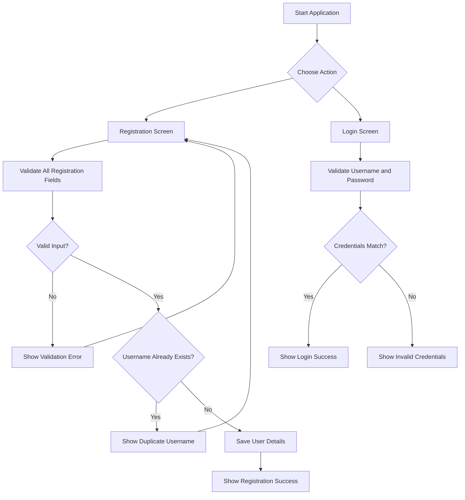

# WPF C# Login and Registration — User Story

## 1. Project Objective

Build a Windows desktop application using WPF that allows a user to register an account and then log in with the registered username and password.

The application should:

- Provide separate Registration and Login screens.
- Collect username, password, age, and email during registration.
- Prevent duplicate usernames.
- Validate user input before saving or logging in.
- Save registration details to a user-specific text file.
- Display clear success and error messages.
- Handle missing, malformed, or inaccessible files without crashing.

> **Learning note:** This project demonstrates basic WPF controls, click events, conditional statements, file handling, string splitting, and validation. Plain-text password storage is acceptable only as a deliberately simplified classroom example—not for production use.

---

## 2. User Stories

### US-001 — User Registration

**As a** new user,  
**I want to** create an account using my username, password, age, and email address,  
**So that** I can use those credentials to log in later.

#### Functional Requirements

1. Display Username, Password, Age, and Email fields.
2. Require all fields to be completed.
3. Check whether the username already exists.
4. If the username exists, display `User Name already exist`.
5. Validate age and email format before saving.
6. Save valid registration details to a file in the application's data directory.
7. Display `Register Success` after successful registration.
8. Display a helpful error message if saving fails.

### US-002 — User Login

**As a** registered user,  
**I want to** log in using my username and password,  
**So that** I can access the application.

#### Functional Requirements

1. Display Username and Password fields.
2. Require both fields.
3. Find the user file associated with the supplied username.
4. Verify that the saved username and password match the entered credentials.
5. Display `Login Success` when the credentials match.
6. Display `Invalid username and password` when the username does not exist or the credentials do not match.
7. Handle malformed or inaccessible user files safely.

---

## 3. UI Design

### 3.1 Login Window

```text
+------------------------------------------+
|              WELCOME BACK                |
|          Login to your account           |
|                                          |
|  Username                                |
|  [ Enter your username                ]  |
|                                          |
|  Password                                |
|  [ Enter your password                ]  |
|                                          |
|                [ Login ]                 |
|                                          |
|     Don't have an account? Register      |
+------------------------------------------+
```

#### Suggested WPF Controls

| UI Element | Control Name | WPF Control |
|---|---|---|
| Username | `txtuser` | `TextBox` |
| Password | `pwpassword` | `PasswordBox` |
| Login button | `btnlogin` | `Button` |
| Register navigation | `btnGoRegister` | `Button` or `TextBlock` |

### 3.2 Registration Window

```text
+------------------------------------------+
|              CREATE ACCOUNT              |
|       Enter your details to register     |
|                                          |
|  Username                                |
|  [ Enter username                     ]  |
|                                          |
|  Password                                |
|  [ Enter password                     ]  |
|                                          |
|  Age                                     |
|  [ Enter age                          ]  |
|                                          |
|  Email                                   |
|  [ Enter email address                ]  |
|                                          |
|              [ Register ]                |
|                                          |
|       Already registered? Login          |
+------------------------------------------+
```

#### Suggested WPF Controls

| UI Element | Control Name | WPF Control |
|---|---|---|
| Username | `txtreguser` | `TextBox` |
| Password | `pwregpassword` | `PasswordBox` |
| Age | `txtage` | `TextBox` |
| Email | `txtemail` | `TextBox` |
| Register button | `btnreg` | `Button` |
| Login navigation | `btnGoLogin` | `Button` or `TextBlock` |

#### UI Guidelines

- Keep labels clearly associated with their input fields.
- Use `PasswordBox` so the password is masked on screen.
- Make primary buttons easy to identify.
- Display validation messages near the relevant field or in a clear message dialog.
- Set keyboard tab order logically.
- Provide navigation between Login and Registration screens.

---

## 4. Validation Rules

### 4.1 Registration Validation

| ID | Field / Condition | Validation Rule | Expected Result |
|---|---|---|---|
| REG-01 | Username | Must not be empty or whitespace | `Please enter username` |
| REG-02 | Username | Must be unique | `User Name already exist` |
| REG-03 | Password | Must not be empty or whitespace | `Please enter password` |
| REG-04 | Age | Must be a positive integer within the age range chosen for the project | `Please enter a valid age` |
| REG-05 | Email | Must not be empty and must have a valid email format | `Please enter a valid email address` |
| REG-06 | All fields | Validate every required field before saving | Do not save invalid data |
| REG-07 | File save | File or permission errors must be handled | `Unable to register. Please try again` |

### 4.2 Login Validation

| ID | Field / Condition | Validation Rule | Expected Result |
|---|---|---|---|
| LOG-01 | Username | Must not be empty or whitespace | `Please enter username` |
| LOG-02 | Password | Must not be empty or whitespace | `Please enter password` |
| LOG-03 | User file | Must exist for the supplied username | `Invalid username and password` |
| LOG-04 | Credentials | Username and password must match the saved credentials | `Invalid username and password` |
| LOG-05 | Successful login | Both credentials match | `Login Success` |
| LOG-06 | File read | Missing access or file errors must be handled safely | `Unable to log in. Please try again` |
| LOG-07 | File contents | Must contain the expected fields | Handle malformed data without crashing |
| LOG-08 | Username | Must not contain invalid filename characters | Show a username validation message |

**Important:** These are the intended rules. The starter code below implements only some of them. Students should implement the remaining validation rules.

---

## 5. Data File Format

The starter code uses the pipe character (`|`) to separate fields.

Example file name: `john.txt`

```text
john|ExamplePassword123|25|john@example.com
```

Field order:

1. Username
2. Password
3. Age
4. Email

The login code reads the username from `splitcontent[0]` and the password from `splitcontent[1]`.

### File Handling Considerations

- Ensure `mainAppData` points to a suitable application data directory.
- Create the directory before writing files if it does not exist.
- Check that a file contains the expected number of fields before reading array indexes.
- Handle `IOException`, `UnauthorizedAccessException`, and malformed content.
- Consider usernames containing `|`, which would break this simple file format.
- Do not treat a filename check alone as sufficient input validation.

> **Security warning:** This classroom format stores passwords in plain text. Do not use it for real users. Production applications should store password hashes generated by a reputable password-hashing algorithm, use secure authentication practices, and normally store user records in a database.

---

## 6. Acceptance Criteria

### US-001 — Registration

- [ ] The Registration screen displays Username, Password, Age, and Email.
- [ ] Empty or whitespace-only required fields are rejected.
- [ ] A duplicate username is rejected.
- [ ] Age must be a valid positive integer within the project's defined range.
- [ ] Email must have an acceptable format.
- [ ] Registration details are saved only after validation passes.
- [ ] Successful registration displays `Register Success`.
- [ ] File errors are handled without crashing the application.

### US-002 — Login

- [ ] The Login screen displays Username and Password.
- [ ] Empty username and password values are rejected.
- [ ] Correct credentials display `Login Success`.
- [ ] An unknown username displays `Invalid username and password`.
- [ ] An incorrect password displays `Invalid username and password`.
- [ ] Malformed or inaccessible user files do not crash the application.
- [ ] The application does not reveal whether a particular username exists through different login error messages.

---

## 7. Test Cases

### 7.1 Registration Test Cases

| Test ID | Scenario | Test Input / Action | Expected Result |
|---|---|---|---|
| TC-REG-01 | Valid registration | Enter valid details for a new username | Registration succeeds and user file is created |
| TC-REG-02 | Duplicate username | Register using an existing username | `User Name already exist` |
| TC-REG-03 | Empty username | Leave username blank | Username validation message |
| TC-REG-04 | Whitespace username | Enter spaces as username | Username validation message |
| TC-REG-05 | Empty password | Leave password blank | Password validation message |
| TC-REG-06 | Invalid age | Enter letters or a negative number | Age validation message |
| TC-REG-07 | Invalid email | Enter an invalid email value | Email validation message |
| TC-REG-08 | Missing email | Leave email blank | Email validation message |
| TC-REG-09 | Invalid filename characters | Enter a username containing invalid filename characters | Username validation message |
| TC-REG-10 | File write failure | Test with an unavailable or non-writable directory | Error message; application remains responsive |

### 7.2 Login Test Cases

| Test ID | Scenario | Test Input / Action | Expected Result |
|---|---|---|---|
| TC-LOG-01 | Valid login | Enter a registered username and correct password | `Login Success` |
| TC-LOG-02 | Incorrect password | Enter a registered username and wrong password | `Invalid username and password` |
| TC-LOG-03 | Unknown username | Enter a username with no corresponding file | `Invalid username and password` |
| TC-LOG-04 | Empty username | Leave username blank | Username validation message |
| TC-LOG-05 | Empty password | Leave password blank | Password validation message |
| TC-LOG-06 | Whitespace username | Enter spaces as username | Username validation message |
| TC-LOG-07 | Malformed user file | Remove a required field from the file | Safe error handling; no crash |
| TC-LOG-08 | File read failure | Test an inaccessible user file | Safe error handling; no crash |
| TC-LOG-09 | Case handling | Try username with different letter casing | Behavior follows the documented username policy |

---

## 8. Application Workflow



---

## 9. Suggested Student Tasks

1. Create the Login and Registration WPF windows.
2. Name the controls according to the tables in Section 3.
3. Implement the Registration button click event.
4. Implement the Login button click event.
5. Add username and password validation.
6. Add age and email validation.
7. Add duplicate username checking.
8. Handle file and malformed-data errors.
9. Execute every test case and record Pass/Fail.
10. Explain how `Path.Combine`, `File.Exists`, `File.ReadAllText`, `File.WriteAllText`, and `Split` work.

### Learning Questions

- Why is `PasswordBox` used instead of `TextBox` for passwords?
- What does `string.IsNullOrWhiteSpace()` check?
- What does `Path.Combine()` do?
- Why must file contents be validated before accessing `splitcontent[1]`?
- What is the difference between validation and authentication?
- Why is plain-text password storage unsafe?
- What happens if two users attempt to register the same username at nearly the same time?

---

## 10. Definition of Done

- [ ] Both screens are implemented.
- [ ] Registration and login workflows work as specified.
- [ ] Required fields and formats are validated.
- [ ] Duplicate usernames are rejected.
- [ ] File errors and malformed records are handled.
- [ ] All test cases are executed and documented.
- [ ] The code is readable and control names are consistent.
- [ ] Password storage limitations are understood and documented.

**Deliverable:** A working WPF Login and Registration application, its source code, and completed test results.
