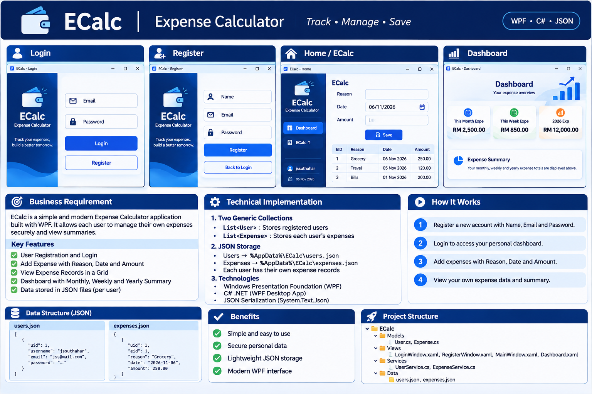
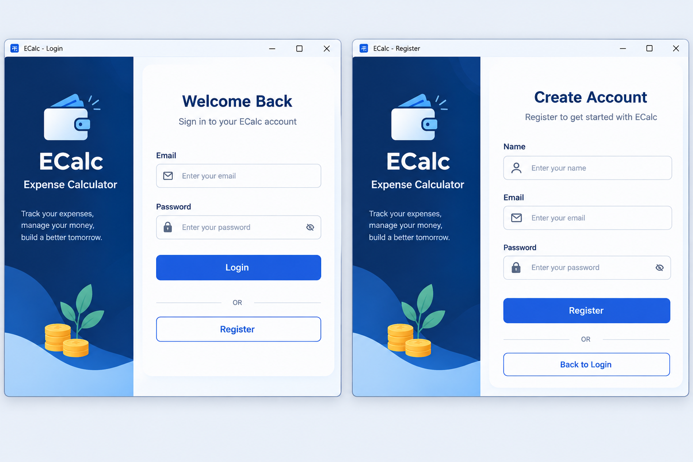
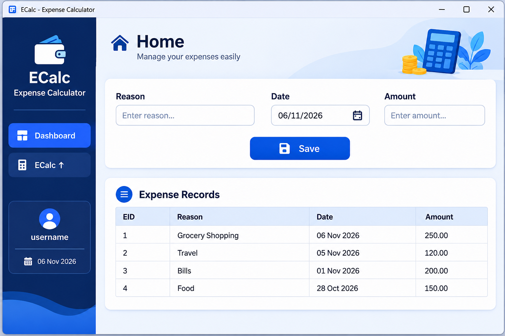
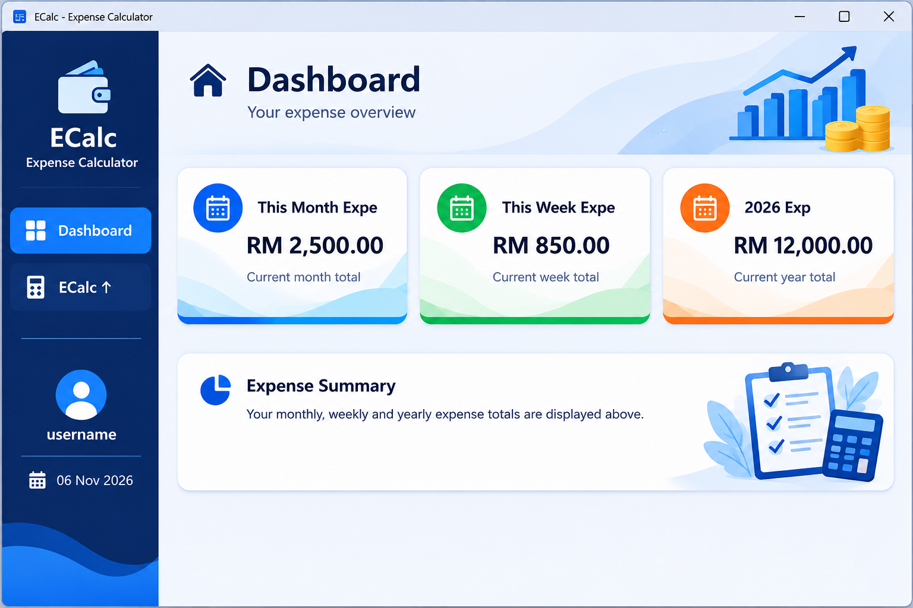
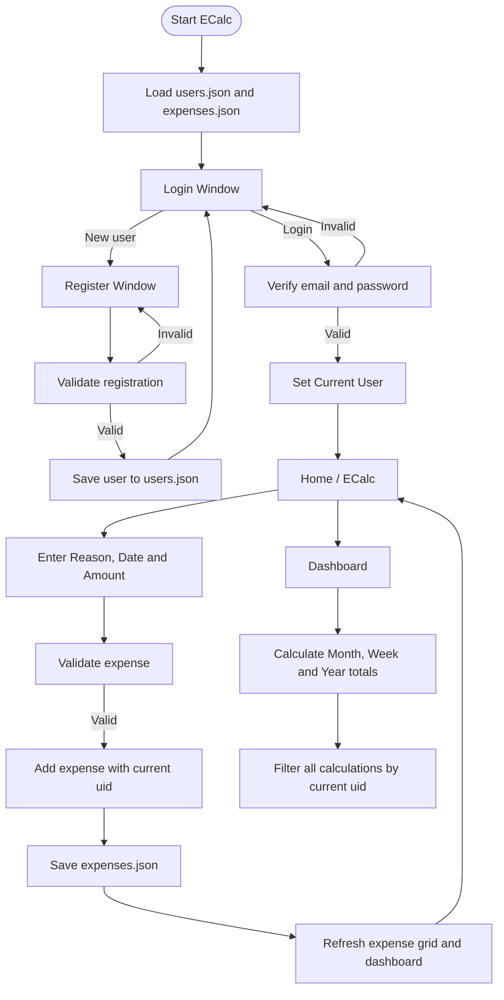

# ECalc – Expense Calculator

A Windows desktop expense-tracking application built with **C# and WPF**. ECalc allows different users to register, log in, and manage their own expense records. Data is stored locally in JSON files under the current Windows user's AppData folder.



---

## 1. Project Overview

| Item | Description |
|---|---|
| Application name | ECalc – Expense Calculator |
| Application type | Windows desktop application |
| UI technology | Windows Presentation Foundation (WPF) |
| Programming language | C# |
| Framework | .NET |
| Data storage | JSON files |
| Storage location | `%LOCALAPPDATA%\\ECalc\\` |
| Collection types | `List<User>` and `List<Expense>` |

### Project objective

Build a simple personal expense calculator where multiple users can use the same application on one Windows computer. Each user must log in to view and manage only their own expense records.

## 2. Business Requirements

### BR-01: User Registration

The application shall allow a new user to create an account.

**Fields**
- Name
- Email
- Password

**Business rules**
- All fields are mandatory.
- Email must have a valid format.
- Email must be unique, ignoring letter casing and surrounding spaces.
- Password must meet the application's minimum password policy.
- Passwords must never be saved as plain text. Store a salted password hash.

**Expected result:** A valid registration creates one user record in `users.json` and returns the user to the Login screen.

### BR-02: User Login

The application shall allow registered users to log in using their email and password.

**Fields**
- Email
- Password

**Business rules**
- Both fields are mandatory.
- The email must match a registered user.
- The entered password must verify against the stored password hash.
- Invalid credentials must show a friendly error message.
- A successful login opens the Home / ECalc screen.
- The application shall retain the logged-in user's `uid` in the current session.


### BR-03: Add Expense

The logged-in user shall be able to add an expense.

**Fields – exactly as in the supplied wireframe**
- Reason
- Date (defaults to today's date)
- Amount
- Save button

**Business rules**
- Reason is mandatory and cannot contain only spaces.
- Date is mandatory.
- Amount must be a valid decimal number greater than zero.
- A new expense receives a unique `eid`.
- The expense must be linked to the logged-in user's `uid`.
- After a successful save, clear the Reason and Amount fields, reset Date to today, and refresh the grid and dashboard totals.

### BR-04: View Expense Records

The Home / ECalc screen shall display the logged-in user's expense records in a DataGrid.

**Grid columns**
- EID
- Reason
- Date
- Amount

**Business rules**
- Display only expenses whose `uid` matches the logged-in user.
- Sort records by date, newest first.
- Do not display another user's records.

### BR-05: Dashboard

The Dashboard shall display three expense summaries for the logged-in user.

| Summary | Calculation |
|---|---|
| This Month Expense | Sum of expenses from the first through the last day of the current month |
| This Week Expense | Sum from Monday through Sunday of the current week |
| Current Year Expense | Sum from January 1 through December 31 of the current year |

**Business rules**
- Use the current system date to calculate the periods.
- Use the logged-in user's `uid` when calculating all totals.
- Display zero when there are no expenses in a period.
- The year label must update automatically (for example, `2026 Expense`).

### BR-06: User Separation

Different users may register and use the same installed application.

**Business rules**
- Each user has a unique `uid`.
- Every expense record stores the owner's `uid`.
- All expense queries and dashboard calculations must filter by the active user's `uid`.
- Logging out clears the active session.
- A user must log in again to access their own records.

> **Local application security note:** AppData JSON storage provides per-Windows-profile local storage, not server-grade isolation between Windows accounts. Any person with access to the same Windows profile and files may be able to inspect or modify the JSON files. Password hashing and user filtering are required, but they do not encrypt the expense file. If stronger protection is required, add file encryption and appropriate Windows file permissions.

---

## 3. Screen Requirements

### 3.1 Login Window

**Controls**
- Email TextBox
- PasswordBox
- Login Button
- Register navigation button/link

**Navigation**
- Register opens the Register Window.
- Successful Login opens the Main Window.
- Failed Login stays on the Login Window and displays a validation message.

### 3.2 Register Window

**Controls**
- Name TextBox
- Email TextBox
- PasswordBox
- Register Button
- Back to Login navigation button/link

**Navigation**
- Successful registration returns to Login.
- Duplicate email or invalid input displays a validation message.

### 3.3 Home / ECalc Screen

**Controls and fields**
- Dashboard navigation
- ECalc navigation
- Logged-in username
- Current date
- Reason TextBox
- DatePicker (default: today)
- Amount TextBox
- Save Button
- Expense DataGrid

### 3.4 Dashboard Screen

**Summary cards**
1. This Month Expense
2. This Week Expense
3. Current Year Expense



---

## 4. Technical Implementation

### 4.1 Two Generic Collections

Use exactly two main generic collections in the application service layer:

```csharp
List<User> users = new List<User>();
List<Expense> expenses = new List<Expense>();
```

| Collection | Purpose |
|---|---|
| `List<User>` | Holds registered user records loaded from `users.json` |
| `List<Expense>` | Holds expense records loaded from `expenses.json` |

The collections are loaded from JSON when the application starts or when the relevant service is initialized. After a change, serialize the updated collection back to its JSON file.

### 4.2 JSON File Storage in AppData

Use the current Windows user's Local AppData folder.

**Resolved folder:**

```text
%LOCALAPPDATA%\ECalc\
```

**Files:**

```text
%LOCALAPPDATA%\ECalc\
    users.json
    expenses.json
```

In C#, resolve the folder instead of hardcoding a Windows username or path:

```csharp
string appDataFolder = Path.Combine(
    Environment.GetFolderPath(
        Environment.SpecialFolder.LocalApplicationData),
    "ECalc");

Directory.CreateDirectory(appDataFolder);

string usersFile = Path.Combine(appDataFolder, "users.json");
string expensesFile = Path.Combine(appDataFolder, "expenses.json");
```

### 4.3 User Model

```csharp
public class User
{
    public int uid { get; set; }
    public string username { get; set; } = "";
    public string email { get; set; } = "";

    // Store a salted password hash, never the original password.
    public string passwordHash { get; set; } = "";
    public string passwordSalt { get; set; } = "";
}
```

### 4.4 Expense Model

```csharp
public class Expense
{
    public int eid { get; set; }
    public int uid { get; set; }

    public string reason { get; set; } = "";
    public DateTime date { get; set; }
    public decimal amount { get; set; }
}
```

`uid` is the owner link. It is essential for separating each user's expense records.

### 4.5 Example users.json

The example uses placeholder values. The password hash and salt must be generated by the application.

```json
[
  {
    "uid": 1,
    "username": "Arun",
    "email": "arun@example.com",
    "passwordHash": "<generated-password-hash>",
    "passwordSalt": "<generated-salt>"
  },
  {
    "uid": 2,
    "username": "Priya",
    "email": "priya@example.com",
    "passwordHash": "<generated-password-hash>",
    "passwordSalt": "<generated-salt>"
  }
]
```

### 4.6 Example expenses.json

```json
[
  {
    "eid": 1,
    "uid": 1,
    "reason": "Groceries",
    "date": "2026-11-06T00:00:00",
    "amount": 250.00
  },
  {
    "eid": 2,
    "uid": 1,
    "reason": "Travel",
    "date": "2026-11-05T00:00:00",
    "amount": 120.00
  },
  {
    "eid": 3,
    "uid": 2,
    "reason": "Electricity Bill",
    "date": "2026-11-06T00:00:00",
    "amount": 180.00
  }
]
```

In this example, Arun sees records 1 and 2. Priya sees record 3. Both users' expenses are stored in the same `expenses.json` file, separated by `uid`.

---

## 5. JSON Read and Write Implementation

Use `System.Text.Json`.

```csharp
using System.Text.Json;

public static class JsonFileService
{
    private static readonly JsonSerializerOptions Options = new()
    {
        WriteIndented = true,
        PropertyNameCaseInsensitive = true
    };

    public static List<T> Read<T>(string filePath)
    {
        if (!File.Exists(filePath))
            return new List<T>();

        string json = File.ReadAllText(filePath);

        return JsonSerializer.Deserialize<List<T>>(json, Options)
               ?? new List<T>();
    }

    public static void Write<T>(string filePath, List<T> data)
    {
        string? folder = Path.GetDirectoryName(filePath);

        if (!string.IsNullOrWhiteSpace(folder))
            Directory.CreateDirectory(folder);

        string json = JsonSerializer.Serialize(data, Options);

        // Write to a temporary file first, then replace the target.
        string tempFile = filePath + ".tmp";
        File.WriteAllText(tempFile, json);
        File.Move(tempFile, filePath, true);
    }
}
```

For a production application, also handle file access errors, invalid JSON, interrupted writes, and backup/recovery. Do not silently overwrite a file that cannot be read.

## 6. Expense Operations

### Save an Expense

```csharp
public void AddExpense(
    int loggedInUserId,
    string reason,
    DateTime date,
    decimal amount)
{
    List<Expense> expenses =
        JsonFileService.Read<Expense>(expensesFile);

    int nextId = expenses.Count == 0
        ? 1
        : expenses.Max(x => x.eid) + 1;

    Expense expense = new Expense
    {
        eid = nextId,
        uid = loggedInUserId,
        reason = reason.Trim(),
        date = date.Date,
        amount = amount
    };

    expenses.Add(expense);

    JsonFileService.Write(expensesFile, expenses);
}
```

### Get Logged-in User's Expenses

```csharp
public List<Expense> GetUserExpenses(int loggedInUserId)
{
    List<Expense> expenses =
        JsonFileService.Read<Expense>(expensesFile);

    return expenses
        .Where(x => x.uid == loggedInUserId)
        .OrderByDescending(x => x.date)
        .ThenByDescending(x => x.eid)
        .ToList();
}
```

### Dashboard Calculations

```csharp
public decimal GetMonthlyExpense(
    int userId, DateTime today)
{
    var expenses = GetUserExpenses(userId);

    return expenses
        .Where(x => x.date.Year == today.Year
                 && x.date.Month == today.Month)
        .Sum(x => x.amount);
}

public decimal GetWeeklyExpense(
    int userId, DateTime today)
{
    var expenses = GetUserExpenses(userId);

    int daysFromMonday =
        ((int)today.DayOfWeek + 6) % 7;

    DateTime weekStart = today.Date.AddDays(-daysFromMonday);
    DateTime weekEnd = weekStart.AddDays(7);

    return expenses
        .Where(x => x.date >= weekStart
                 && x.date < weekEnd)
        .Sum(x => x.amount);
}

public decimal GetYearlyExpense(
    int userId, DateTime today)
{
    var expenses = GetUserExpenses(userId);

    return expenses
        .Where(x => x.date.Year == today.Year)
        .Sum(x => x.amount);
}
```

All dashboard methods must receive the authenticated user's ID. Never calculate totals from the full collection without filtering by `uid`.

---

## 7. Suggested Project Structure

```text
ECalc/
│
├── Models/
│   ├── User.cs
│   └── Expense.cs
│
├── Views/
│   ├── LoginWindow.xaml
│   ├── RegisterWindow.xaml
│   ├── MainWindow.xaml
│   └── Dashboard.xaml
│
├── ViewModels/
│   ├── LoginViewModel.cs
│   ├── RegisterViewModel.cs
│   ├── MainViewModel.cs
│   └── DashboardViewModel.cs
│
├── Services/
│   ├── JsonFileService.cs
│   ├── UserService.cs
│   ├── ExpenseService.cs
│   └── PasswordService.cs
│
├── Helpers/
│   └── ValidationHelper.cs
│
├── App.xaml
└── App.xaml.cs
```

### Responsibilities

| Class | Responsibility |
|---|---|
| `User` | User data model |
| `Expense` | Expense data model |
| `JsonFileService` | Read and write JSON files |
| `UserService` | Register, validate login, find user |
| `ExpenseService` | Add and retrieve expenses, calculate totals |
| `PasswordService` | Generate and verify salted password hashes |
| `LoginViewModel` | Login screen behavior |
| `RegisterViewModel` | Registration screen behavior |
| `DashboardViewModel` | Display expense summaries |

---

## 8. Application Workflow



---

## 9. Acceptance Criteria

- [ ] A new user can register with Name, Email and Password.
- [ ] Duplicate email registration is rejected.
- [ ] Password is stored as a salted hash, not plain text.
- [ ] A registered user can log in.
- [ ] An invalid login is rejected.
- [ ] Each user has a unique `uid`.
- [ ] User data is stored in `users.json`.
- [ ] Expense data is stored in `expenses.json`.
- [ ] Both JSON files are stored in `%LOCALAPPDATA%\\ECalc\\`.
- [ ] The application uses `List<User>` and `List<Expense>`.
- [ ] An expense is saved with the logged-in user's `uid`.
- [ ] The expense grid displays only the current user's records.
- [ ] The monthly total is correct.
- [ ] The weekly total uses Monday as the first day of the week.
- [ ] The yearly total uses the current calendar year.
- [ ] A user cannot see another user's expenses through the application.
- [ ] Data remains available after closing and reopening the application.

## 10. Test Scenarios

| # | Scenario | Expected result |
|---|---|---|
| 1 | Register a new user | User is saved in JSON |
| 2 | Register with an existing email | Duplicate email message |
| 3 | Login with correct credentials | Home screen opens |
| 4 | Login with incorrect password | Login error |
| 5 | Save with empty Reason | Validation message |
| 6 | Save with invalid or zero Amount | Validation message |
| 7 | Save a valid expense | Record is saved with current `uid` |
| 8 | Login as another user | Only that user's expenses appear |
| 9 | Check monthly summary | Only current user's monthly total |
| 10 | Restart the application | Previously saved data loads again |

---

## 11. Scope and Constraints

**Included in version 1**
- Login and registration
- Add expense
- Expense history grid
- Monthly, weekly and yearly dashboard summaries
- Two generic collections
- Local JSON file persistence
- Per-user expense filtering

**Not included in version 1**
- SQL Server or cloud database
- Expense categories
- Edit or delete expense
- Reports or PDF export
- Multi-device synchronization
- Online authentication

## 12. Development Plan

1. Create the WPF project and folder structure.
2. Create `User` and `Expense` models.
3. Implement the two generic collections and JSON storage service.
4. Build Register and Login windows.
5. Implement password hashing and user authentication.
6. Build the ECalc expense entry and DataGrid.
7. Implement user-specific expense filtering.
8. Build Dashboard monthly, weekly and yearly calculations.
9. Test with at least two different users.
10. Verify JSON persistence after restarting the application.

---

**Project name:** ECalc – Expense Calculator  
**UI:** C# WPF  
**Storage:** JSON files in Windows Local AppData  
**Collections:** `List<User>` and `List<Expense>`  
**Architecture:** Models + Views + ViewModels + Services
