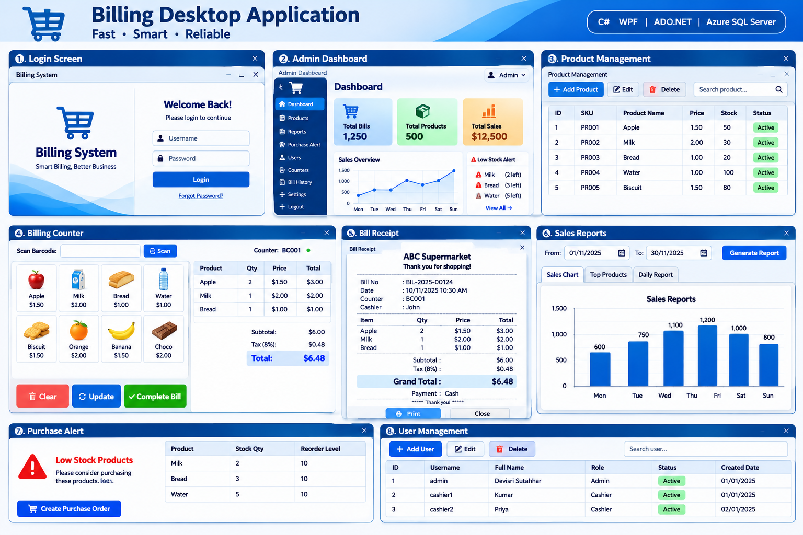
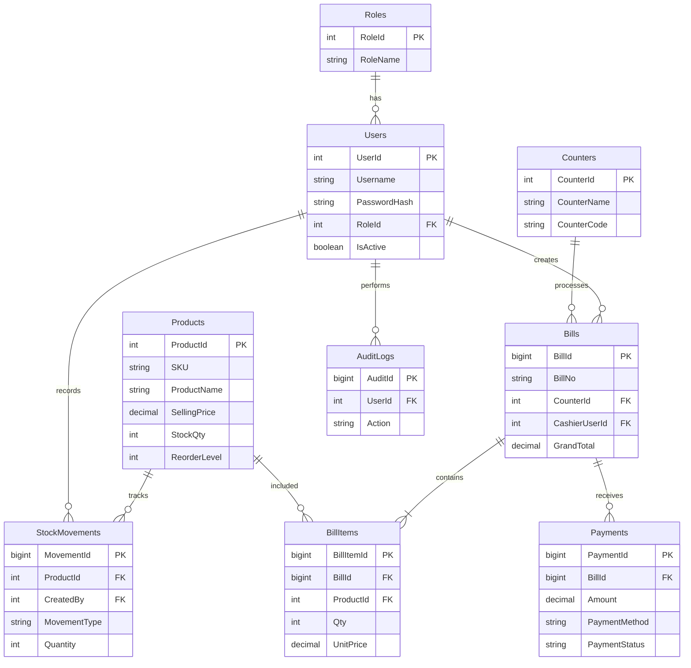
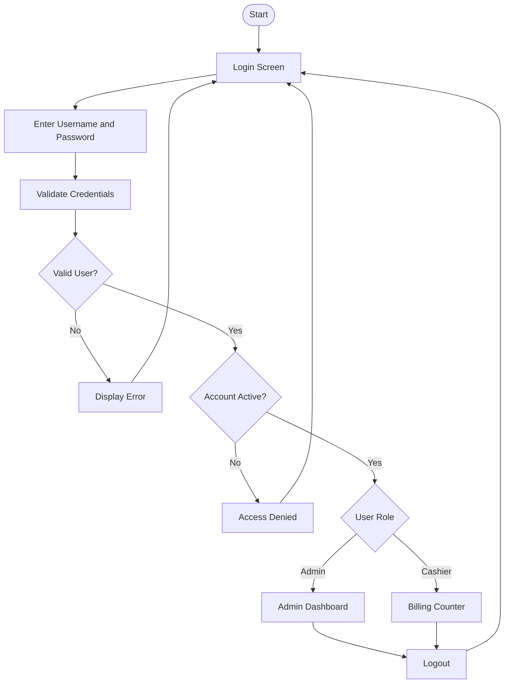
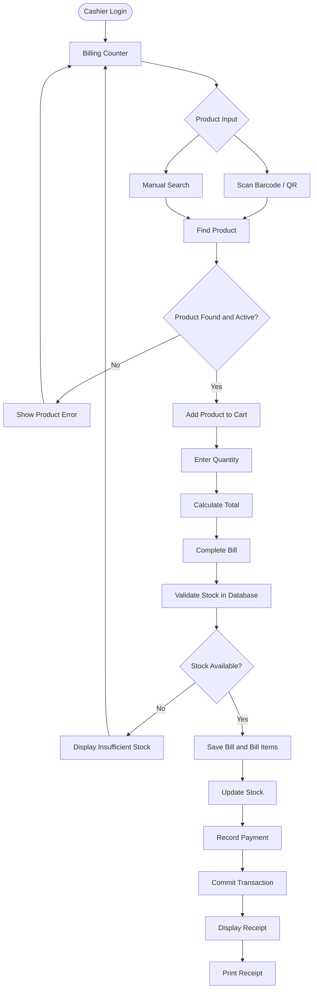
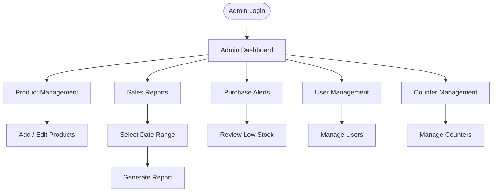
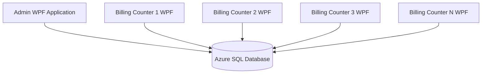

# Billing Desktop Application

A Windows-based Billing and Inventory Management System developed using C# WPF, ADO.NET, and Azure SQL Server.

The application supports multiple billing counters connected to a centralized database. Administrators can manage products, prices, stock, users, and sales reports, while billing counter users can scan products, generate bills, and print receipts.



---

# 1. Project Overview

## Project Details

| Property | Description |
|---|---|
| Project Name | Billing Desktop Application |
| Application Type | Windows Desktop Application |
| Frontend | WPF |
| Programming Language | C# |
| UI Design | XAML |
| Database Connectivity | ADO.NET |
| Database | Azure SQL Server |
| IDE | Visual Studio |
| Architecture | Layered Architecture |
| Users | Admin and Billing Counter |
| Deployment | Windows Desktop |

## Project Description

The Billing Desktop Application is designed to simplify product billing and inventory management.

The application provides two primary roles:

1. **Admin**
   - Manage products.
   - Manage selling prices.
   - Manage stock.
   - View sales reports.
   - Monitor purchase and stock alerts.
   - Manage billing counter users.

2. **Billing Counter**
   - Scan product QR codes or barcodes.
   - Search products manually.
   - Add products to the billing cart.
   - Update product quantities.
   - Calculate the bill automatically.
   - Complete payment and generate receipts.

Multiple billing counters can operate simultaneously using the same centralized Azure SQL database.

---

# 2. Problem Statement

Traditional billing systems and manual billing processes can create several business problems:

- Manual billing takes more time.
- Product prices may be entered incorrectly.
- Stock information may not be updated immediately.
- Multiple counters may sell the same available stock.
- Administrators may find it difficult to monitor daily sales.
- Low-stock products may not be identified on time.
- Maintaining historical sales records can be difficult.

## Proposed Solution

Develop a centralized billing application that:

- Automates product billing.
- Maintains product and inventory information.
- Supports multiple billing counters.
- Automatically updates stock after successful sales.
- Generates sales reports.
- Identifies products requiring replenishment.

---

# 3. Technology Stack

| Technology | Usage |
|---|---|
| C# | Application development |
| WPF | Desktop UI |
| XAML | Screen design |
| ADO.NET | Database communication |
| Azure SQL Server | Centralized database |
| SQL Server | Queries, stored procedures and transactions |
| Visual Studio | Development environment |
| Barcode / QR Scanner | Product identification |
| WPF Printing | Receipt printing |

## Why WPF?

WPF (Windows Presentation Foundation) is a Microsoft framework used to develop Windows desktop applications.

Advantages:

- XAML-based UI development.
- Data binding.
- Reusable styles and templates.
- Custom controls.
- Separation of UI and business logic.

## Why ADO.NET?

ADO.NET is used to communicate with SQL Server databases.

Important classes:

| Class | Purpose |
|---|---|
| SqlConnection | Establish database connection |
| SqlCommand | Execute SQL commands |
| SqlDataReader | Read database records |
| SqlDataAdapter | Fill DataTable / DataSet |
| SqlTransaction | Manage database transactions |
| SqlParameter | Pass parameterized values |

## Why Azure SQL Server?

Azure SQL provides a centralized database that can be accessed by multiple authorized billing counter computers.

---

# 4. Application Roles

## 4.1 Admin

Admin has access to the administrative functionalities.

Features:

- Admin Login.
- Dashboard.
- Product Management.
- Price Management.
- Stock Management.
- Billing Counter Management.
- User Management.
- Sales Reports.
- Purchase Alerts.
- Bill History.

## 4.2 Billing Counter

Billing Counter users can perform sales transactions.

Features:

- Billing Counter Login.
- QR / Barcode Scanning.
- Manual Product Search.
- Product Selection.
- Quantity Management.
- Automatic Price Calculation.
- Bill Generation.
- Payment Recording.
- Receipt Printing.

Billing Counter users must not access Admin-only functionalities.

---

# 5. Application Screens

| Screen ID | Screen Name | Description |
|---|---|---|
| S01 | Login | User authentication |
| S02 | Admin Dashboard | Sales and inventory summary |
| S03 | Product List | Display all products |
| S04 | Add Product | Create a new product |
| S05 | Edit Product | Update product information |
| S06 | Billing Counter | Scan and select products |
| S07 | Billing Cart | Manage selected products |
| S08 | Bill Summary | Calculate final amount |
| S09 | Payment | Record payment |
| S10 | Receipt | Display and print receipt |
| S11 | Sales Report | Display sales information |
| S12 | Purchase Alert | Display low-stock products |
| S13 | User Management | Manage application users |
| S14 | Counter Management | Manage billing terminals |
| S15 | Bill History | Search historical bills |

---

# 6. Database Design

Database Name:

`BillingManagementDB`

The application uses a centralized Azure SQL database.

## Database Tables

| No. | Table Name | Purpose |
|---|---|---|
| 1 | Roles | Maintain application roles |
| 2 | Users | Maintain Admin and Cashier accounts |
| 3 | Counters | Maintain billing counter information |
| 4 | Products | Maintain product details |
| 5 | Bills | Maintain bill header information |
| 6 | BillItems | Maintain products included in each bill |
| 7 | Payments | Maintain payment details |
| 8 | StockMovements | Maintain stock movement history |
| 9 | AuditLogs | Maintain user activity history |

## 6.1 Roles Table

Table Name: `Roles`

Stores application role information.

| Column | Data Type | Constraint | Description |
|---|---|---|---|
| RoleId | INT | PK, Identity | Unique role ID |
| RoleName | NVARCHAR(50) | NOT NULL, UNIQUE | Admin / Cashier |
| Description | NVARCHAR(250) | NULL | Role description |
| CreatedAt | DATETIME2 | NOT NULL | Created date |

Example Data:

| RoleId | RoleName |
|---|---|
| 1 | Admin |
| 2 | Cashier |

## 6.2 Users Table

Table Name: `Users`

Stores user login and profile information.

| Column | Data Type | Constraint | Description |
|---|---|---|---|
| UserId | INT | PK, Identity | Unique user ID |
| Username | NVARCHAR(100) | NOT NULL, UNIQUE | Login username |
| PasswordHash | NVARCHAR(500) | NOT NULL | Hashed password |
| FullName | NVARCHAR(150) | NOT NULL | User full name |
| Email | NVARCHAR(150) | NULL | Email address |
| Phone | NVARCHAR(20) | NULL | Phone number |
| RoleId | INT | FK | User role |
| IsActive | BIT | NOT NULL | Account status |
| CreatedAt | DATETIME2 | NOT NULL | Created date |
| UpdatedAt | DATETIME2 | NULL | Updated date |

Relationship:

`Roles.RoleId → Users.RoleId`

## 6.3 Counters Table

Table Name: `Counters`

Stores billing counter information.

| Column | Data Type | Constraint | Description |
|---|---|---|---|
| CounterId | INT | PK, Identity | Counter ID |
| CounterName | NVARCHAR(100) | NOT NULL | Counter name |
| CounterCode | NVARCHAR(50) | NOT NULL, UNIQUE | Counter code |
| Location | NVARCHAR(150) | NULL | Counter location |
| IsActive | BIT | NOT NULL | Counter status |
| CreatedAt | DATETIME2 | NOT NULL | Created date |

Example:

| CounterId | CounterName | CounterCode |
|---|---|---|
| 1 | Billing Counter 1 | BC001 |
| 2 | Billing Counter 2 | BC002 |
| 3 | Billing Counter 3 | BC003 |

## 6.4 Products Table

Table Name: `Products`

Stores product information.

| Column | Data Type | Constraint | Description |
|---|---|---|---|
| ProductId | INT | PK, Identity | Product ID |
| SKU | NVARCHAR(50) | NOT NULL, UNIQUE | Product code |
| Barcode | NVARCHAR(100) | NULL, UNIQUE | Barcode / QR value |
| ProductName | NVARCHAR(200) | NOT NULL | Product name |
| Description | NVARCHAR(500) | NULL | Product description |
| SellingPrice | DECIMAL(18,2) | NOT NULL | Selling price |
| StockQty | INT | NOT NULL | Available stock |
| ReorderLevel | INT | NOT NULL | Minimum stock |
| IsActive | BIT | NOT NULL | Product status |
| CreatedAt | DATETIME2 | NOT NULL | Created date |
| UpdatedAt | DATETIME2 | NULL | Updated date |

Example:

| ProductId | SKU | ProductName | SellingPrice | StockQty |
|---|---|---|---:|---:|
| 1 | PR001 | Notebook | 5.00 | 100 |
| 2 | PR002 | Pen | 2.00 | 200 |
| 3 | PR003 | Pencil | 1.00 | 150 |

Important Business Rule:

If:

`StockQty <= ReorderLevel`

The product must appear in the Admin Purchase Alert screen.

## 6.5 Bills Table

Table Name: `Bills`

Stores the main bill information.

| Column | Data Type | Constraint | Description |
|---|---|---|---|
| BillId | BIGINT | PK, Identity | Bill ID |
| BillNo | NVARCHAR(50) | NOT NULL, UNIQUE | Bill number |
| CounterId | INT | FK | Billing counter |
| CashierUserId | INT | FK | Cashier user |
| BillDate | DATETIME2 | NOT NULL | Bill date |
| Subtotal | DECIMAL(18,2) | NOT NULL | Total before adjustments |
| Discount | DECIMAL(18,2) | NOT NULL | Discount amount |
| Tax | DECIMAL(18,2) | NOT NULL | Tax amount |
| GrandTotal | DECIMAL(18,2) | NOT NULL | Final bill amount |
| Status | NVARCHAR(20) | NOT NULL | Completed / Voided |
| CreatedAt | DATETIME2 | NOT NULL | Created date |

Relationships:

- `Counters.CounterId → Bills.CounterId`
- `Users.UserId → Bills.CashierUserId`

## 6.6 BillItems Table

Table Name: `BillItems`

Stores individual products included in each bill.

| Column | Data Type | Constraint | Description |
|---|---|---|---|
| BillItemId | BIGINT | PK, Identity | Bill item ID |
| BillId | BIGINT | FK | Parent bill |
| ProductId | INT | FK | Product ID |
| ProductNameSnapshot | NVARCHAR(200) | NOT NULL | Product name at sale time |
| Qty | INT | NOT NULL | Sold quantity |
| UnitPrice | DECIMAL(18,2) | NOT NULL | Price at sale time |
| LineTotal | DECIMAL(18,2) | NOT NULL | Quantity × unit price |

Relationships:

- `Bills.BillId → BillItems.BillId`
- `Products.ProductId → BillItems.ProductId`

Example:

| BillItemId | BillId | ProductId | Qty | UnitPrice | LineTotal |
|---|---|---|---:|---:|---:|
| 1 | 1001 | 1 | 2 | 5.00 | 10.00 |
| 2 | 1001 | 2 | 3 | 2.00 | 6.00 |

Important:

Store the original selling price in BillItems. If the Admin changes a product price later, previous bills must retain their original prices.

## 6.7 Payments Table

Table Name: `Payments`

Stores payment information for each bill.

| Column | Data Type | Constraint | Description |
|---|---|---|---|
| PaymentId | BIGINT | PK, Identity | Payment ID |
| BillId | BIGINT | FK | Related bill |
| PaymentMethod | NVARCHAR(30) | NOT NULL | Cash / Card / Other |
| Amount | DECIMAL(18,2) | NOT NULL | Payment amount |
| PaymentStatus | NVARCHAR(20) | NOT NULL | Paid / Pending / Failed |
| TransactionReference | NVARCHAR(100) | NULL | External reference |
| PaymentDate | DATETIME2 | NOT NULL | Payment date |

Relationship:

`Bills.BillId → Payments.BillId`

The design supports multiple payment records per bill if split payments are required. For a simple student version, one successful payment per bill can be implemented first.

## 6.8 StockMovements Table

Table Name: `StockMovements`

Maintains the history of stock changes.

| Column | Data Type | Constraint | Description |
|---|---|---|---|
| MovementId | BIGINT | PK, Identity | Movement ID |
| ProductId | INT | FK | Product ID |
| MovementType | NVARCHAR(30) | NOT NULL | StockIn / Sale / Adjustment / Reversal |
| Quantity | INT | NOT NULL | Movement quantity |
| ReferenceId | BIGINT | NULL | Related bill or adjustment |
| Remarks | NVARCHAR(250) | NULL | Reason |
| CreatedBy | INT | FK | User ID |
| CreatedAt | DATETIME2 | NOT NULL | Movement date |

Relationship:

- `Products.ProductId → StockMovements.ProductId`
- `Users.UserId → StockMovements.CreatedBy`

Example:

| MovementId | ProductId | MovementType | Quantity |
|---|---|---|---:|
| 1 | 1 | StockIn | 100 |
| 2 | 1 | Sale | -2 |
| 3 | 1 | Adjustment | 5 |

## 6.9 AuditLogs Table

Table Name: `AuditLogs`

Maintains important application activity.

| Column | Data Type | Constraint | Description |
|---|---|---|---|
| AuditId | BIGINT | PK, Identity | Audit ID |
| UserId | INT | FK | User ID |
| Action | NVARCHAR(100) | NOT NULL | Action performed |
| EntityName | NVARCHAR(100) | NULL | Table / entity |
| EntityId | NVARCHAR(100) | NULL | Record ID |
| Details | NVARCHAR(MAX) | NULL | Activity details |
| CreatedAt | DATETIME2 | NOT NULL | Activity date |

Examples:

- Admin added a product.
- Admin changed a selling price.
- Cashier completed a bill.
- Admin deactivated a product.

Do not store passwords, authentication tokens, or sensitive payment information in audit logs.

---

# 7. Complete Database Relationship Diagram



---

# 8. SQL Server Database Creation

```sql
CREATE DATABASE BillingManagementDB;
GO

USE BillingManagementDB;
GO
```

## 8.1 Create Roles

```sql
CREATE TABLE Roles
(
    RoleId INT IDENTITY(1,1) PRIMARY KEY,
    RoleName NVARCHAR(50) NOT NULL UNIQUE,
    Description NVARCHAR(250) NULL,
    CreatedAt DATETIME2 NOT NULL DEFAULT SYSUTCDATETIME()
);
```

## 8.2 Create Users

```sql
CREATE TABLE Users
(
    UserId INT IDENTITY(1,1) PRIMARY KEY,
    Username NVARCHAR(100) NOT NULL UNIQUE,
    PasswordHash NVARCHAR(500) NOT NULL,
    FullName NVARCHAR(150) NOT NULL,
    Email NVARCHAR(150) NULL,
    Phone NVARCHAR(20) NULL,
    RoleId INT NOT NULL,
    IsActive BIT NOT NULL DEFAULT 1,
    CreatedAt DATETIME2 NOT NULL DEFAULT SYSUTCDATETIME(),
    UpdatedAt DATETIME2 NULL,

    CONSTRAINT FK_Users_Roles
        FOREIGN KEY (RoleId) REFERENCES Roles(RoleId)
);
```

## 8.3 Create Counters

```sql
CREATE TABLE Counters
(
    CounterId INT IDENTITY(1,1) PRIMARY KEY,
    CounterName NVARCHAR(100) NOT NULL,
    CounterCode NVARCHAR(50) NOT NULL UNIQUE,
    Location NVARCHAR(150) NULL,
    IsActive BIT NOT NULL DEFAULT 1,
    CreatedAt DATETIME2 NOT NULL DEFAULT SYSUTCDATETIME()
);
```

## 8.4 Create Products

```sql
CREATE TABLE Products
(
    ProductId INT IDENTITY(1,1) PRIMARY KEY,
    SKU NVARCHAR(50) NOT NULL UNIQUE,
    Barcode NVARCHAR(100) NULL UNIQUE,
    ProductName NVARCHAR(200) NOT NULL,
    Description NVARCHAR(500) NULL,
    SellingPrice DECIMAL(18,2) NOT NULL,
    StockQty INT NOT NULL DEFAULT 0,
    ReorderLevel INT NOT NULL DEFAULT 5,
    IsActive BIT NOT NULL DEFAULT 1,
    CreatedAt DATETIME2 NOT NULL DEFAULT SYSUTCDATETIME(),
    UpdatedAt DATETIME2 NULL,

    CONSTRAINT CK_Products_SellingPrice
        CHECK (SellingPrice >= 0),

    CONSTRAINT CK_Products_StockQty
        CHECK (StockQty >= 0),

    CONSTRAINT CK_Products_ReorderLevel
        CHECK (ReorderLevel >= 0)
);
```

## 8.5 Create Bills

```sql
CREATE TABLE Bills
(
    BillId BIGINT IDENTITY(1,1) PRIMARY KEY,
    BillNo NVARCHAR(50) NOT NULL UNIQUE,
    CounterId INT NOT NULL,
    CashierUserId INT NOT NULL,
    BillDate DATETIME2 NOT NULL DEFAULT SYSUTCDATETIME(),
    Subtotal DECIMAL(18,2) NOT NULL,
    Discount DECIMAL(18,2) NOT NULL DEFAULT 0,
    Tax DECIMAL(18,2) NOT NULL DEFAULT 0,
    GrandTotal DECIMAL(18,2) NOT NULL,
    Status NVARCHAR(20) NOT NULL DEFAULT 'Completed',
    CreatedAt DATETIME2 NOT NULL DEFAULT SYSUTCDATETIME(),

    CONSTRAINT FK_Bills_Counters
        FOREIGN KEY (CounterId) REFERENCES Counters(CounterId),

    CONSTRAINT FK_Bills_Users
        FOREIGN KEY (CashierUserId) REFERENCES Users(UserId),

    CONSTRAINT CK_Bills_Status
        CHECK (Status IN ('Completed', 'Voided')),

    CONSTRAINT CK_Bills_Amounts
        CHECK (Subtotal >= 0 AND Discount >= 0
               AND Tax >= 0 AND GrandTotal >= 0)
);
```

## 8.6 Create BillItems

```sql
CREATE TABLE BillItems
(
    BillItemId BIGINT IDENTITY(1,1) PRIMARY KEY,
    BillId BIGINT NOT NULL,
    ProductId INT NOT NULL,
    ProductNameSnapshot NVARCHAR(200) NOT NULL,
    Qty INT NOT NULL,
    UnitPrice DECIMAL(18,2) NOT NULL,
    LineTotal DECIMAL(18,2) NOT NULL,

    CONSTRAINT FK_BillItems_Bills
        FOREIGN KEY (BillId) REFERENCES Bills(BillId),

    CONSTRAINT FK_BillItems_Products
        FOREIGN KEY (ProductId) REFERENCES Products(ProductId),

    CONSTRAINT CK_BillItems_Qty CHECK (Qty > 0),
    CONSTRAINT CK_BillItems_UnitPrice CHECK (UnitPrice >= 0)
);
```

## 8.7 Create Payments

```sql
CREATE TABLE Payments
(
    PaymentId BIGINT IDENTITY(1,1) PRIMARY KEY,
    BillId BIGINT NOT NULL,
    PaymentMethod NVARCHAR(30) NOT NULL,
    Amount DECIMAL(18,2) NOT NULL,
    PaymentStatus NVARCHAR(20) NOT NULL,
    TransactionReference NVARCHAR(100) NULL,
    PaymentDate DATETIME2 NOT NULL DEFAULT SYSUTCDATETIME(),

    CONSTRAINT FK_Payments_Bills
        FOREIGN KEY (BillId) REFERENCES Bills(BillId),

    CONSTRAINT CK_Payments_Amount CHECK (Amount > 0),

    CONSTRAINT CK_Payments_Status
        CHECK (PaymentStatus IN ('Paid', 'Pending', 'Failed'))
);
```

## 8.8 Create StockMovements

```sql
CREATE TABLE StockMovements
(
    MovementId BIGINT IDENTITY(1,1) PRIMARY KEY,
    ProductId INT NOT NULL,
    MovementType NVARCHAR(30) NOT NULL,
    Quantity INT NOT NULL,
    ReferenceId BIGINT NULL,
    Remarks NVARCHAR(250) NULL,
    CreatedBy INT NOT NULL,
    CreatedAt DATETIME2 NOT NULL DEFAULT SYSUTCDATETIME(),

    CONSTRAINT FK_StockMovements_Products
        FOREIGN KEY (ProductId) REFERENCES Products(ProductId),

    CONSTRAINT FK_StockMovements_Users
        FOREIGN KEY (CreatedBy) REFERENCES Users(UserId),

    CONSTRAINT CK_StockMovements_Type
        CHECK (MovementType IN
        ('StockIn', 'Sale', 'Adjustment', 'Reversal'))
);
```

## 8.9 Create AuditLogs

```sql
CREATE TABLE AuditLogs
(
    AuditId BIGINT IDENTITY(1,1) PRIMARY KEY,
    UserId INT NOT NULL,
    Action NVARCHAR(100) NOT NULL,
    EntityName NVARCHAR(100) NULL,
    EntityId NVARCHAR(100) NULL,
    Details NVARCHAR(MAX) NULL,
    CreatedAt DATETIME2 NOT NULL DEFAULT SYSUTCDATETIME(),

    CONSTRAINT FK_AuditLogs_Users
        FOREIGN KEY (UserId) REFERENCES Users(UserId)
);
```

## 8.10 Insert Initial Roles

```sql
INSERT INTO Roles (RoleName, Description)
VALUES
('Admin', 'System administrator'),
('Cashier', 'Billing counter user');
```

---

# 9. Application Flow Diagrams

## 9.1 Login Flow



## 9.2 Billing Flow



## 9.3 Admin Flow



---

# 10. Multi-Counter System Architecture



All authorized computers access the same central data.

## Important Multi-Counter Scenario

Assume a product has only one unit available.

- Counter 1 adds the product to the cart.
- Counter 2 adds the same product to the cart.
- Both users attempt to complete their bills.

The system must not allow both transactions to sell the same unit.

Use a database transaction and conditional stock update.

```sql
UPDATE Products
SET StockQty = StockQty - @Quantity
WHERE ProductId = @ProductId
  AND StockQty >= @Quantity;
```

Check affected rows:

- One row affected: Stock deduction succeeded.
- Zero rows affected: Stock is insufficient.

If any part of checkout fails, roll back the transaction.

The bill header, bill items, payment record, stock update, and stock movement must be handled consistently within the transaction.

---

# 11. Recommended Project Folder Structure

```text
BillingDesktop.sln
|
+-- BillingDesktop.UI
|   |
|   +-- Views
|   |   +-- LoginWindow.xaml
|   |   +-- AdminDashboard.xaml
|   |   +-- ProductList.xaml
|   |   +-- ProductForm.xaml
|   |   +-- BillingCounter.xaml
|   |   +-- ReceiptWindow.xaml
|   |   +-- SalesReport.xaml
|   |
|   +-- ViewModels
|   +-- Resources
|   +-- Converters
|   +-- App.xaml
|
+-- BillingDesktop.Business
|   |
|   +-- Services
|   |   +-- AuthService.cs
|   |   +-- ProductService.cs
|   |   +-- BillingService.cs
|   |   +-- InventoryService.cs
|   |   +-- ReportService.cs
|   |
|   +-- Interfaces
|   +-- Validators
|   +-- DTOs
|
+-- BillingDesktop.Data
|   |
|   +-- Repositories
|   +-- Database
|   |   +-- SqlConnectionFactory.cs
|   +-- Scripts
|
+-- BillingDesktop.Models
|   |
|   +-- Entities
|   +-- Enums
|
+-- BillingDesktop.Tests
    |
    +-- UnitTests
    +-- IntegrationTests
```

---

# 12. Important Business Rules

1. Username must be unique.
2. SKU must be unique.
3. Barcode must follow the agreed uniqueness rules.
4. Product selling price cannot be negative.
5. Product quantity cannot be negative.
6. Only active products can be sold.
7. Cashier cannot modify product selling prices.
8. Bill number must be unique.
9. Quantity must be greater than zero.
10. Stock must be validated again during checkout.
11. Completed bill details must retain the original product price.
12. Stock must be updated only after successful checkout processing.
13. A failed checkout must not create a partial bill.
14. Products used in historical bills should be deactivated instead of deleted.
15. Only Admin users can access reports and administrative screens.

---

# 13. Security Requirements

- Never store plain-text passwords.
- Use a secure password hashing algorithm.
- Use parameterized SQL commands.
- Implement role-based authorization.
- Use encrypted database connections.
- Restrict Azure SQL network access.
- Protect connection strings and secrets.
- Avoid hardcoding production credentials in source code.
- Log important administrative activities.
- Validate all input values.

**Production recommendation:** Use a secured ASP.NET Core Web API between WPF clients and Azure SQL instead of placing a privileged database connection string inside every desktop client.

---

# 14. Development Plan

| Phase | Task | Expected Result |
|---|---|---|
| 1 | Requirement Analysis | Understand project requirements |
| 2 | UI Design | Design all WPF screens |
| 3 | Database Design | Create SQL tables and relationships |
| 4 | Login Module | Implement authentication |
| 5 | Role Management | Separate Admin and Cashier access |
| 6 | Product Management | Implement product CRUD |
| 7 | Billing Counter | Implement product scanning and search |
| 8 | Cart Management | Implement quantity and total calculations |
| 9 | Bill Generation | Save bills and bill items |
| 10 | Inventory | Update stock safely |
| 11 | Payment | Record payment information |
| 12 | Reports | Generate sales reports |
| 13 | Alerts | Identify low-stock products |
| 14 | Testing | Validate all application features |
| 15 | Deployment | Publish the WPF application |

---

# 15. Testing Scenarios

| Test ID | Scenario | Expected Result |
|---|---|---|
| TC01 | Valid Admin login | Admin Dashboard opens |
| TC02 | Invalid password | Error message displayed |
| TC03 | Cashier login | Billing Counter opens |
| TC04 | Scan valid barcode | Product appears |
| TC05 | Scan invalid barcode | Product not found |
| TC06 | Search product manually | Matching products appear |
| TC07 | Add product to cart | Product added |
| TC08 | Change quantity | Total recalculated |
| TC09 | Quantity exceeds stock | Checkout blocked |
| TC10 | Complete valid bill | Bill saved |
| TC11 | Payment successful | Payment recorded |
| TC12 | Successful sale | Stock reduced |
| TC13 | Low stock product | Purchase alert displayed |
| TC14 | Admin changes price | New price used for future bills |
| TC15 | Old bill displayed | Original price retained |
| TC16 | Two counters sell last item | Only one valid sale succeeds |
| TC17 | Database failure during checkout | Transaction rolled back |
| TC18 | Cashier opens Admin report | Access denied |

---

# 16. Student Project Demonstration

Students must demonstrate the complete application rather than simply showing the UI.

## Recommended Demonstration Order

1. Introduce the project.
2. Explain the business problem.
3. Explain the technology stack.
4. Show the login screen.
5. Sign in as Admin.
6. Show the Admin dashboard.
7. Add a new product.
8. Configure product price and stock.
9. Sign out.
10. Sign in as Cashier.
11. Scan a barcode or search manually.
12. Add products to the billing cart.
13. Change product quantities.
14. Complete the bill.
15. Show the generated receipt.
16. Print the receipt.
17. Sign out and return to Admin.
18. Show the updated stock quantity.
19. Show sales reports.
20. Explain the database relationships.

## Sample Student Presentation

"Good morning.

Our project is a Billing Desktop Application developed using C#, WPF, ADO.NET, and Azure SQL Server.

The main objective of this application is to simplify billing operations and maintain accurate product stock across multiple billing counters.

Our application has two main roles: Admin and Billing Counter.

The Admin can manage products, prices, stock, users, and sales reports.

The Billing Counter user can scan product barcodes or search products manually, add them to the billing cart, enter quantities, and generate bills.

We use a centralized Azure SQL database, which allows multiple billing counters to access the same product and stock information.

When a bill is completed, the system saves the bill details and updates stock within a database transaction.

Now I will demonstrate the complete billing workflow."

---

# 17. Viva and Interview Questions

## WPF

1. What is WPF?
2. What is XAML?
3. What is the difference between WPF and Windows Forms?
4. What is Data Binding?
5. What is the purpose of a ResourceDictionary?
6. What is the difference between StaticResource and DynamicResource?
7. What is MVVM?
8. What is the difference between a UserControl and a Window?

## C#

1. What is a class?
2. What is an interface?
3. What is inheritance?
4. What is polymorphism?
5. What is an abstract class?
6. What is an exception?
7. What is the purpose of async and await?
8. What is the difference between IEnumerable and List?

## ADO.NET

1. What is ADO.NET?
2. What is SqlConnection?
3. What is SqlCommand?
4. What is SqlDataReader?
5. What is SqlDataAdapter?
6. What is ExecuteReader?
7. What is ExecuteScalar?
8. What is ExecuteNonQuery?
9. Why should we use SQL parameters?
10. What is SqlTransaction?

## SQL Server

1. What is a Primary Key?
2. What is a Foreign Key?
3. What is a Unique Constraint?
4. What is an Index?
5. What is a Join?
6. What is a Stored Procedure?
7. What is a Transaction?
8. What are ACID properties?
9. How do you prevent duplicate bill numbers?
10. How do you prevent negative stock?

## Real-Time Scenario Questions

1. What happens if two billing counters sell the same last product?
2. What happens if the database connection is lost during checkout?
3. What happens if the Admin changes a product price after a bill is completed?
4. How do you prevent a cashier from accessing the Admin dashboard?
5. How do you identify products that need replenishment?
6. How do you maintain the history of stock changes?
7. How do you prevent duplicate bill generation?
8. How would you implement product returns?

---

# 18. Future Enhancements

- Customer Management.
- Supplier Management.
- Purchase Order Management.
- Product Returns.
- Discount Management.
- Tax Configuration.
- Excel and PDF Reports.
- Multiple Branch Management.
- Offline Billing and Synchronization.
- Dashboard Analytics.
- Secured ASP.NET Core Web API.
- Cloud Backup and Recovery.

---

# 19. Setup and Execution

## Prerequisites

- Windows 10 / Windows 11.
- Visual Studio.
- .NET SDK compatible with the project.
- SQL Server or Azure SQL Database.
- SQL Server Management Studio (SSMS), optional.
- Barcode scanner, optional.

## Steps

1. Clone the repository.
2. Open `BillingDesktop.sln` in Visual Studio.
3. Restore NuGet packages.
4. Create the Azure SQL database.
5. Execute the SQL creation scripts.
6. Configure the development database connection securely.
7. Build the solution.
8. Run the application.
9. Create development Admin and Cashier accounts.
10. Test the application workflows.

Do not upload production connection strings or database passwords to GitHub.

---

# 20. Final Note to Students

This project is designed to help students understand how a real-world billing and inventory management application works.

Do not focus only on completing the UI.

Understand:

- Why each screen is required.
- Why each database table is required.
- How the tables are related.
- How ADO.NET communicates with SQL Server.
- How billing calculations work.
- How stock is updated.
- How multiple billing counters share data.
- How database transactions protect business data.
- How to handle errors and invalid inputs.

During the final project review, every student must be able to explain the modules they developed and the technical decisions they made.

**A successful project is not just an application that runs. It is an application that you understand, can demonstrate, and can confidently explain.**

---

**Project:** Billing Desktop Application  
**Technologies:** C# | WPF | ADO.NET | Azure SQL Server  
**Architecture:** Layered Architecture  
**Project Type:** Desktop Application
